# lmfluid

Finite elements (MFEM) and lattice-Boltzmann flow for lmscript: worked engineering problems with known answers, each drawn by lmplot, lmdraw or lmcad.

[](https://github.com/lmctl-ai/lmfluid/actions/workflows/ci.yml)
[](https://github.com/lmctl-ai/lmfluid/releases)

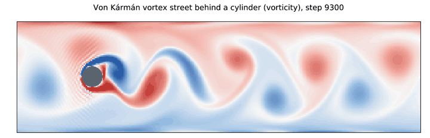

`lmctl autorun https://raw.githubusercontent.com/lmctl-ai/lmfluid/main/examples/cylinder_wake.lms`

Every picture below is made by one example script. Paste its command into a terminal and the same picture appears in `images/` of the current directory.

### Flow

| Vortex shedding, Strouhal 0.32 | Lid-driven cavity against Ghia et al. | A faster lid moves the vortex |
| --- | --- | --- |
| 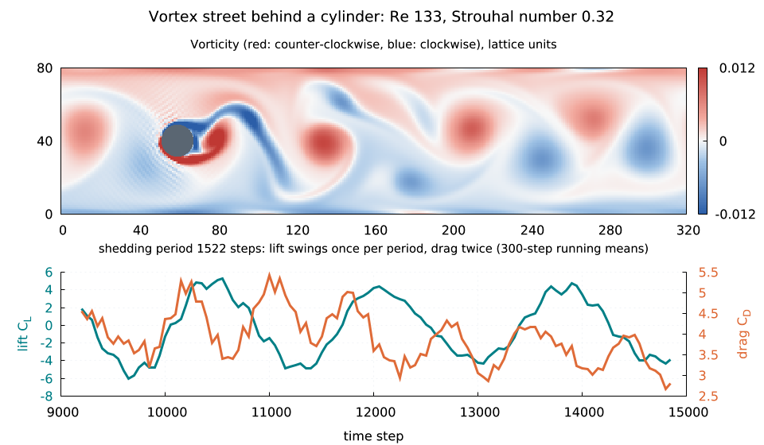 | 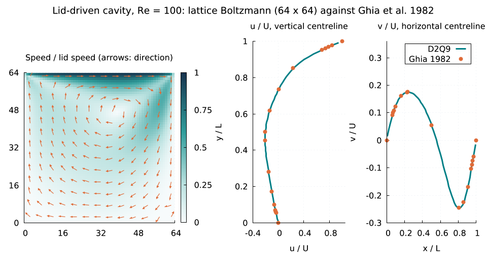 | 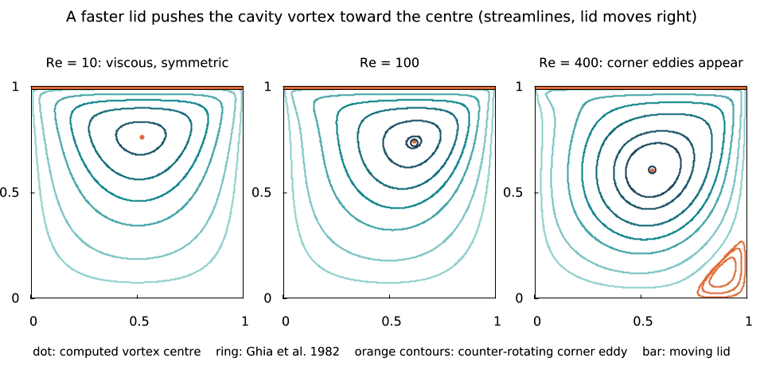 |
| A cylinder in a channel sheds vortices at Re ≈ 130; lift swings once per period, drag twice, and St = fD/U ≈ 0.3 as in the Schäfer & Turek benchmark. | Both centreline velocity profiles at Re = 100 land on the 30 tabulated points of the classic 1982 benchmark. | A what-if sweep over Re = 10, 100, 400: the vortex centre lands on Ghia's coordinates and a corner eddy appears. |
| `lmctl autorun https://raw.githubusercontent.com/lmctl-ai/lmfluid/main/examples/cylinder_wake.lms` | `lmctl autorun https://raw.githubusercontent.com/lmctl-ai/lmfluid/main/examples/cavity_ghia.lms` | `lmctl autorun https://raw.githubusercontent.com/lmctl-ai/lmfluid/main/examples/cavity_vortex.lms` |

| Poiseuille flow and its start-up | Viscosity damps a shear wave |
| --- | --- |
| 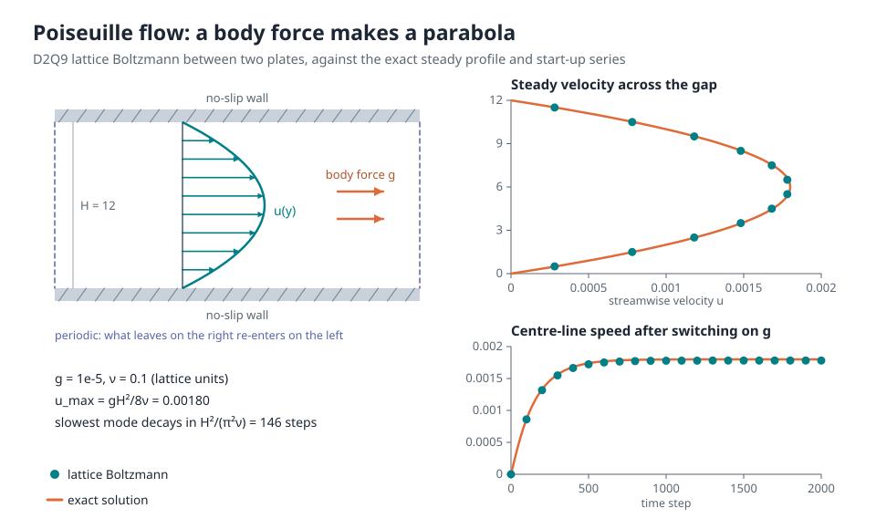 | 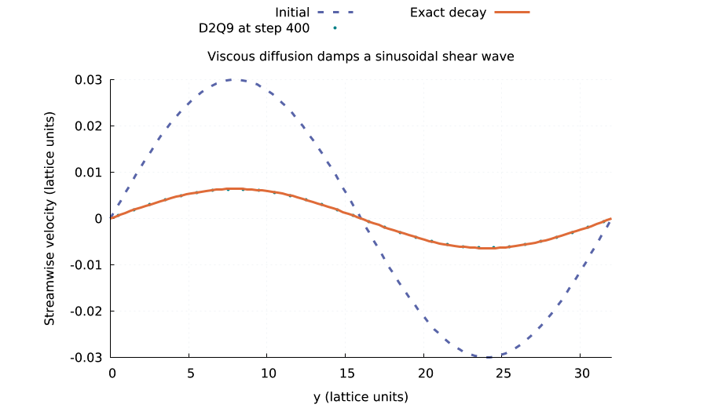 |
| A body force between two plates gives the exact parabola gH²/8ν at the centre, reached along the exact start-up series. | A periodic shear wave decays as exp(-νk²t), the textbook way to measure a lattice's viscosity. |
| `lmctl autorun https://raw.githubusercontent.com/lmctl-ai/lmfluid/main/examples/channel.lms` | `lmctl autorun https://raw.githubusercontent.com/lmctl-ai/lmfluid/main/examples/shear_decay.lms` |

### Structures

| Cantilever against beam theory | The same beam in 3D | Stress concentration at a hole |
| --- | --- | --- |
| 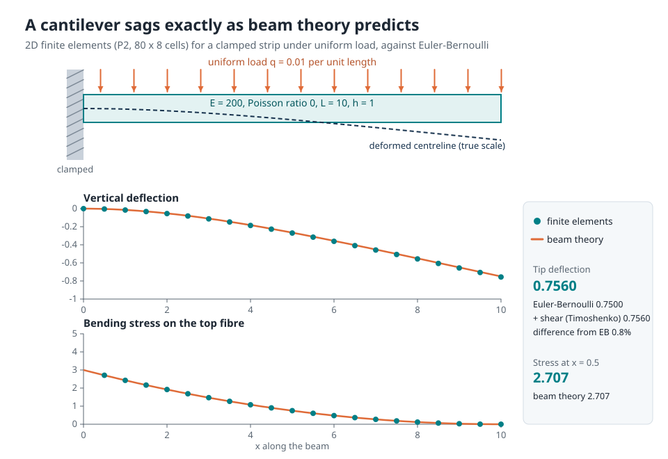 | 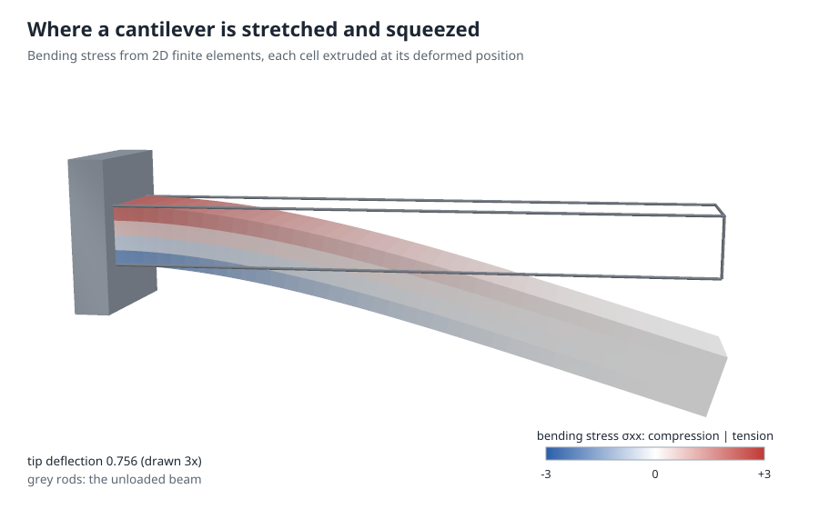 | 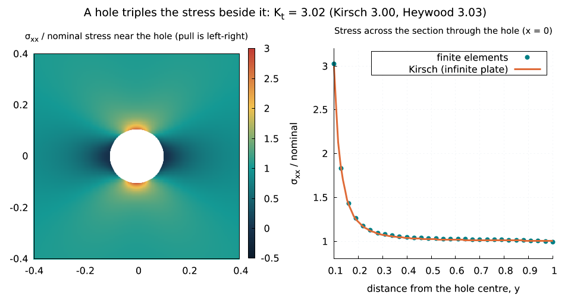 |
| Tip deflection 0.7560 = Euler-Bernoulli 0.7500 + Timoshenko's shear term; stress follows 3q(L-x)²/h². | Each finite element extruded at its deformed position by lmcad: tension on top, compression underneath. | A hole in a plate under tension triples the stress beside it: K_t = 3.02 against Heywood's 3.03. |
| `lmctl autorun https://raw.githubusercontent.com/lmctl-ai/lmfluid/main/examples/cantilever_beam.lms` | `lmctl autorun https://raw.githubusercontent.com/lmctl-ai/lmfluid/main/examples/cantilever_3d.lms` | `lmctl autorun https://raw.githubusercontent.com/lmctl-ai/lmfluid/main/examples/plate_hole.lms` |

| The patch test |
| --- |
| 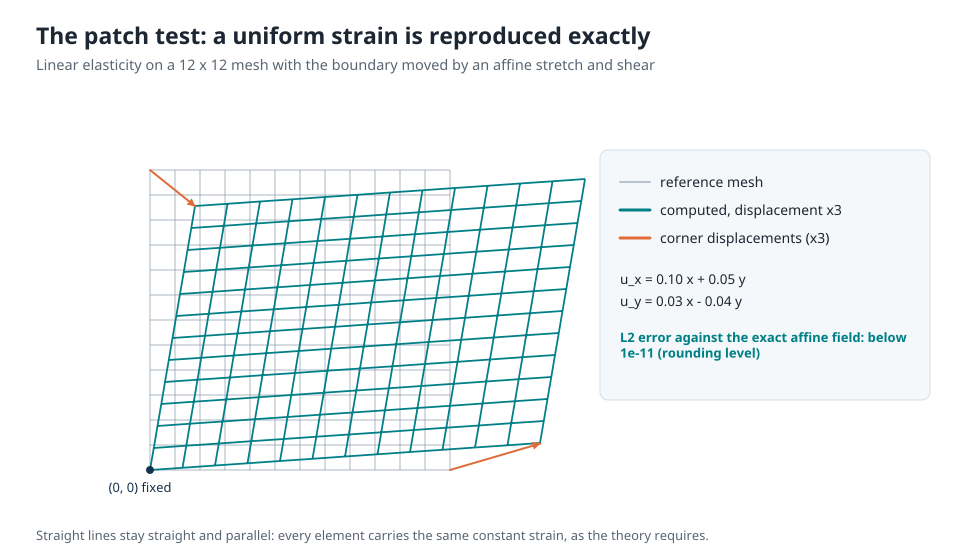 |
| A uniform stretch and shear is reproduced to rounding error, the first thing to check in any element. |
| `lmctl autorun https://raw.githubusercontent.com/lmctl-ai/lmfluid/main/examples/elastic_stretch.lms` |

### Heat

| Insulating a wall | A self-heating block | A cooling plate as a clock |
| --- | --- | --- |
| 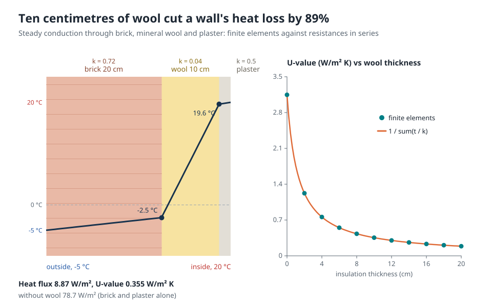 | 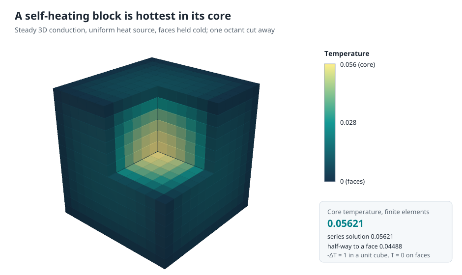 | 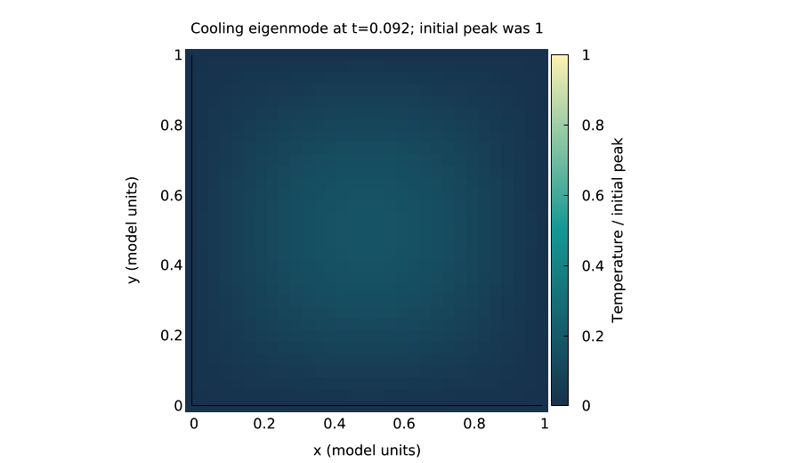 |
| Brick, wool and plaster in series: 10 cm of wool cuts the heat loss by 89%, and the U-value sweep matches 1/Σ(t/k). | Uniform heating with cold faces: the 3D core reaches 0.05621, the series solution. | The slowest mode keeps its shape and decays as exp(-2π²t); [animated](docs/images/heat_clock.gif). |
| `lmctl autorun https://raw.githubusercontent.com/lmctl-ai/lmfluid/main/examples/insulated_wall.lms` | `lmctl autorun https://raw.githubusercontent.com/lmctl-ai/lmfluid/main/examples/heated_cube.lms` | `lmctl autorun https://raw.githubusercontent.com/lmctl-ai/lmfluid/main/examples/heat_clock.lms` |

| Diffusion smooths short wavelengths first |
| --- |
| 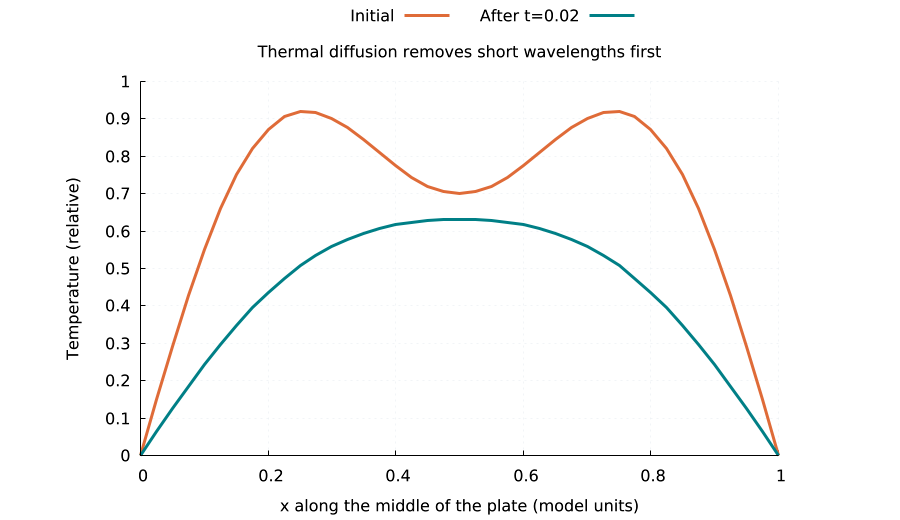 |
| Two hot bumps merge into one as the fine structure decays fastest. |
| `lmctl autorun https://raw.githubusercontent.com/lmctl-ai/lmfluid/main/examples/heated_plate.lms` |

### Numerics

| Convergence study | Boundary data sets the field | A sine source makes a dome |
| --- | --- | --- |
| 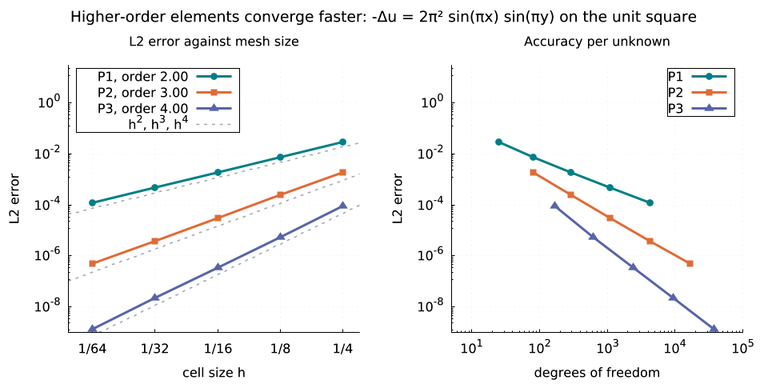 | 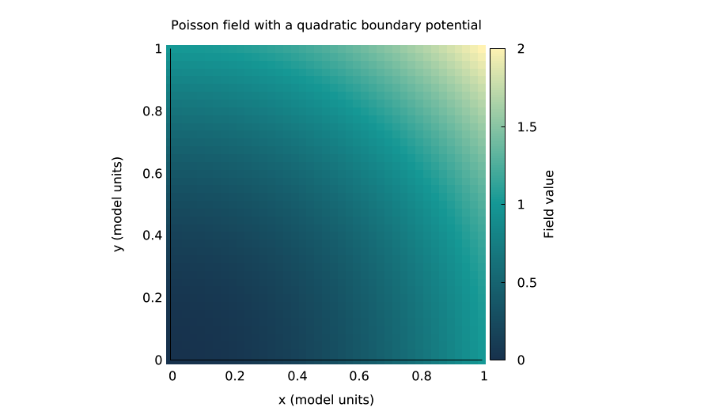 | 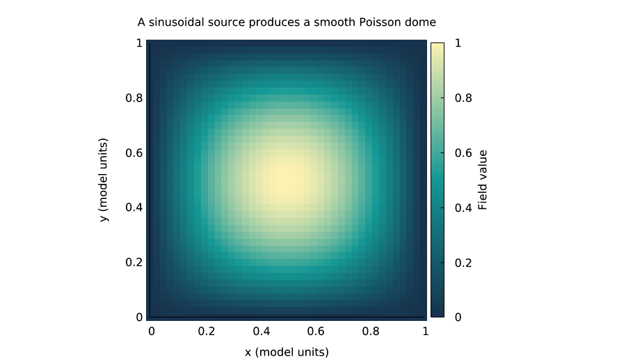 |
| Errors fall as h², h³, h⁴ for P1, P2, P3; per unknown, higher order wins by orders of magnitude. | -Δu = -4 with u = x² + y² on the edges is solved exactly by P2 elements. | The source 2π² sin(πx) sin(πy) gives exactly the dome sin(πx) sin(πy) of height 1. |
| `lmctl autorun https://raw.githubusercontent.com/lmctl-ai/lmfluid/main/examples/fem_convergence.lms` | `lmctl autorun https://raw.githubusercontent.com/lmctl-ai/lmfluid/main/examples/poisson.lms` | `lmctl autorun https://raw.githubusercontent.com/lmctl-ai/lmfluid/main/examples/sine_dome.lms` |

## Quick start (one minute)

```sh
npm install -g @lmctl-ai/lmctl
mkdir try-lmfluid && cd try-lmfluid
lmctl autorun https://raw.githubusercontent.com/lmctl-ai/lmfluid/main/examples/quickstart.lms
```

The first run downloads the released lmfluid and lmdraw binaries for your platform (Linux x64/arm64 binaries require dynamic glibc >= 2.35 and statically link MFEM, libstdc++ and libgcc; macOS arm64/x64 and Windows x64 require no extra runtime libraries) and writes `images/quickstart.png`, which draws the pipeline it just ran:

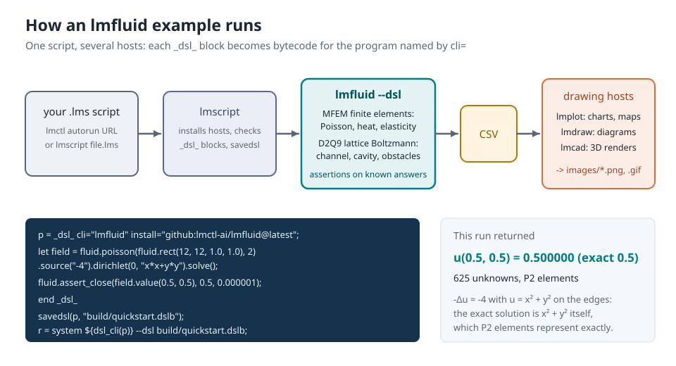

Each script binds its hosts with `_dsl_ cli="..." install="github:lmctl-ai/...@latest"` blocks, so nothing needs to be on PATH. Installing `@latest` asks the GitHub API for the release; without a token GitHub allows 60 such requests an hour from one address, so set `GITHUB_TOKEN` (for example `export GITHUB_TOKEN=$(gh auth token)`) before running many examples. Animated examples also write a GIF when `ffmpeg` is on PATH; otherwise they leave the frames in `build/visual/`.

The program in the picture, written out:

```lmscript
p = _dsl_ cli="lmfluid" install="github:lmctl-ai/lmfluid@latest";
let field = fluid.poisson(fluid.rect(12, 12, 1.0, 1.0), 2).source("-4").dirichlet(0, "x*x+y*y").solve();
fluid.assert_close(field.value(0.5, 0.5), 0.5, 0.000001);
field.sample(41, 41).save_csv("poisson.csv");
end _dsl_
savedsl(p, "poisson.dslb");
r = system ${dsl_cli(p)} --dsl poisson.dslb;
assert(r.code == 0);
```

## API

The host CLI accepts only `--dsl FILE...`, `--dry-run --dsl FILE...`, `--version`, `--notices`, `--dsl-schema [--json]` and `--dsl-signatures`. Dry run validates bytecode without solving or writing files. Usage errors exit 2; load and run errors exit 3. Warnings (see the LBM limits) go to stderr; stdout carries only the JSON result line.

| API | Purpose |
| --- | --- |
| `fluid.rect(nx,ny,lx,ly)`, `fluid.box(nx,ny,nz,lx,ly,lz)` | Cartesian quad/hex mesh |
| `fluid.load_mesh(path)`, `mesh.save(path)` | MFEM mesh file input/output (v1.0/v1.2) |
| `mesh.dimension()`, `mesh.elements()` | mesh metadata |
| `fluid.poisson(mesh,order)`, `fluid.heat(...)`, `fluid.elasticity(...)` | finite-element problem (orders 1–3) |
| `problem.diffusion("expr")`, `.source("expr")`, `.initial("expr")` | scalar coefficients, source and heat initial condition |
| `problem.dirichlet(attribute,"expr")` | scalar essential boundary condition; attribute 0 selects all boundaries |
| `problem.lame(lambda,mu)`, `.force(fx,fy,fz)` | isotropic elastic material and expression body force |
| `problem.displacement(attribute,ux,uy,uz)` | vector essential boundary condition (all components) |
| `problem.tol(relative_tolerance,max_iterations)` | iterative linear solver controls |
| `problem.solve()` | steady Poisson or elasticity field |
| `problem.evolve(end_time,dt)` | heat field at end time, starting at t=0 |
| `field.value(x,y)` / `.value(x,y,z,component)` | value at a mesh point, zero-based component |
| `field.gradient(x,y,direction)` / `.gradient(x,y,z,component,direction)` | derivative of a component along x (0), y (1) or z (2): fluxes, strains, stresses |
| `field.l2_error("exact")`, `.l2_error_vector(ex,ey,ez)` | integrated L2 error |
| `field.sample(nx,ny)` / `.sample(nx,ny,nz)` | sample bounding-box grid into a matrix |
| `field.dofs()`, `.components()`, `.time()` | solution metadata |
| `fluid.channel(nx,ny,nu,g)`, `.cavity(nx,ny,nu,lid_speed)`, `.periodic(nx,ny,nu)` | D2Q9 flow simulation |
| `flow.obstacle("expr")` | mark cells whose centre gives expr > 0 as solid (no-slip, halfway bounceback); calls add up |
| `flow.init(ux_expr,uy_expr)`, `.run(steps)` | initialize velocities and advance integer lattice steps |
| `flow.velocity(ix,iy,component)`, `.density(ix,iy)`, `.is_solid(ix,iy)` | cell values, zero-based indices |
| `flow.solid_force(component)`, `.solid_cells()` | momentum-exchange force on all obstacle cells, averaged over the last `run`; solid cell count |
| `flow.vorticity()` | matrix `x,y,omega,solid` (central differences, no-slip walls) |
| `flow.mass()`, `.max_speed()`, `.mach()`, `.tau()`, `.kinetic_energy()`, `.steps()` | diagnostics (fluid cells only) |
| `flow.sample()` | lattice data matrix |
| `fluid.matrix(rows,cols)`, `matrix.set(row,col,value)` | a zero matrix to record results (time series, sweeps) for CSV |
| `matrix.rows()`, `.cols()`, `.get(row,col)`, `.save_csv(path)` | matrix access and deterministic CSV |
| `fluid.eval("expr")`, `.assert_close(a,b,absolute_tolerance)`, `.assert_true(bool)` | mathematical helper and assertions |

Poisson solves `-div(k grad u)=f`. Heat solves `u_t-div(k grad u)=f` using backward Euler; diffusion and source expressions may depend on time. Elasticity solves `-div(lambda*tr(epsilon) I + 2*mu*epsilon)=force` (plane strain in 2D). The default essential boundary data is zero on all faces. Selecting a specific boundary replaces that default, and unselected faces get homogeneous natural conditions (insulated / traction-free). Boundary attributes of `fluid.rect` are 1 bottom (y=0), 2 right (x=lx), 3 top, 4 left; of `fluid.box` 1 bottom (z=0), 2 front (y=0), 3 right (x=lx), 4 back, 5 left, 6 top. Attribute `0` avoids depending on a numbering.

Expressions use `x,y,z,t`, arithmetic, `^`, `pi` and functions such as `sin`, `cos`, `exp`, `log`, `sqrt`, `abs`, `min`, `max` and `sign` (`0.5+0.5*sign(x-a)` is a step at x = a). For 2D, z=0; the third force/displacement expression is unused. A solved field owns its mesh and space; altering the problem does not alter it. Point queries outside the mesh fail. FEM CSV columns are `x,y,z,u` or `x,y,z,ux,uy[,uz]`; LBM CSV columns are `x,y,rho,ux,uy,speed` at cell centres `(ix+0.5,iy+0.5)`. Files have no header, deterministic order and 17 significant digits.

## Limits, honestly

- **LBM is low-Mach and weakly compressible**, in lattice units, with BGK collisions, Guo forcing and halfway bounceback. Keep speeds below about 0.1 (Mach 0.17); `run` warns on stderr once the Mach number exceeds 0.3 and stops with an error at speed 0.45. A relaxation time `tau = 0.5 + 3 nu` below 0.51 also warns: BGK is fragile there. Obstacles are staircase (cell) shapes, so curved walls are first-order accurate.
- **No inlet/outlet boundaries, turbulence, free surfaces or multiphase flow.** Channel flow is periodic along x and driven by a body force, so a cylinder in a channel is really a row of cylinders.
- **FEM is serial MFEM** with H1 elements for Poisson, heat and linear elasticity: no Navier-Stokes FEM, no mixed or vector-component (roller) boundary conditions, no eigenvalue solver, no adaptive refinement, no MPI or GPU.
- Byte-identical CSVs are checked on the same platform; other platforms agree to rounding.

## Build and verification

```sh
scripts/sync-deps.sh
cmake -S . -B build -DCMAKE_BUILD_TYPE=Release
cmake --build build --parallel 4
./test.sh
examples/render-all.sh   # regenerate docs/images (and the GIFs when ffmpeg is present)
```

Requires CMake 3.24+, C++17, git, Python 3 and lmscript for testing (`npm i -g @lmctl-ai/lmctl@0.2.369`). MFEM is built statically with exceptions and no MPI, METIS, OpenMP, GPU, LAPACK, zlib or other external numerical libraries. Linux binaries dynamically link glibc (>= 2.35) and statically link MFEM, libstdc++ and libgcc; macOS links only system libraries; Windows statically links MinGW runtimes.

`test.sh` checks manufactured solutions, P1/P2/P3 convergence orders, heat eigenmode decay, the elasticity patch test, cantilever deflection, slope and stress against beam theory, 3D Poisson and mesh round trips, periodic mass and momentum, shear-wave decay, the Poiseuille profile, obstacle walls against domain walls, the momentum balance on obstacles, Ghia's Re = 100 cavity, deterministic reruns, schema and signature parity, notices and platform linkage (dynamic glibc >= 2.35 allowlist on Linux, static MFEM everywhere), 25 error cases and the stability warnings. It runs every example (each asserts its own known answer) and validates the gallery. See [durable memory](durable-memory/index.md) for measurements and scope.

## Resource limits

A program may use at most 4096 MiB in total (meshes, FE spaces and solver matrices, LBM grids,
sampled matrices, everything the host keeps); beyond that it stops with a run error (exit 3) naming
the limit, instead of exhausting the machine. Set `LMFLUID_MAX_MEMORY_MB` to change it, e.g.
`LMFLUID_MAX_MEMORY_MB=16384 lmscript big.lms`.

## License

Our host, wrappers, examples and D2Q9 implementation are [MIT](LICENSE). MFEM is BSD-3-Clause and is fetched at the commit in `deps.lock` into ignored `third_party/`; its bundled permissive notices are reproduced in [THIRD_PARTY_NOTICES](THIRD_PARTY_NOTICES) and embedded in `--notices`. OpenFOAM and GPL/LGPL scientific libraries are excluded. The drawing hosts (lmplot, lmdraw, lmcad) are separate programs installed at run time under their own licenses.
